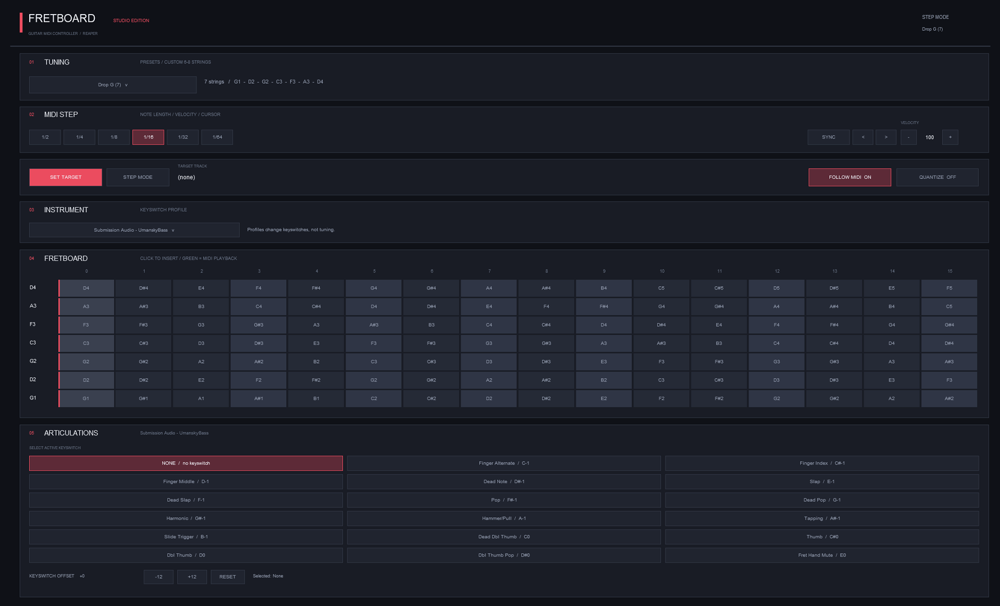

# 🎸 Guitar MIDI Fretboard .lua for Reaper

A free and customizable Lua ReaScript for **REAPER DAW**, designed to make writing guitar and bass MIDI faster and more intuitive.

Create MIDI notes directly from an interactive fretboard, experiment with different tunings, and control instrument articulations without relying entirely on the traditional piano roll.

### Features

- Interactive fretboard with direct MIDI note insertion
- STEP and LIVE input modes
- Standard, Drop and Custom tunings (6, 7 and 8 strings)
- MIDI playback visualization
- Articulation keyswitches for supported VST instruments
- Customizable note length, velocity and quantization
- Dark, modern interface

### Download
[⬇ Download Guitar MIDI Fretboard](https://github.com/arsondim/guitar-midi-fretboard-reaper/main/Guitar_MIDI_Fretboard.lua)

### Installation

1. Download the `.lua` script.
2. Open REAPER → `Actions → Show action list`.
3. Select `New action → Load ReaScript`.
4. Choose the downloaded script and click `Run`.

### AI-Generated & Open to Modification

This project was created with the assistance of **AI**.

The code is freely available for anyone to explore, edit, modify, customize and improve. Feel free to adapt it to your own workflow, experiment with new features or contribute to the project.

### Website

For more information, downloads and feature demonstrations, visit:

**https://rearson.dev**

---

*An independent community project. Not affiliated with Cockos or Submission Audio.*
